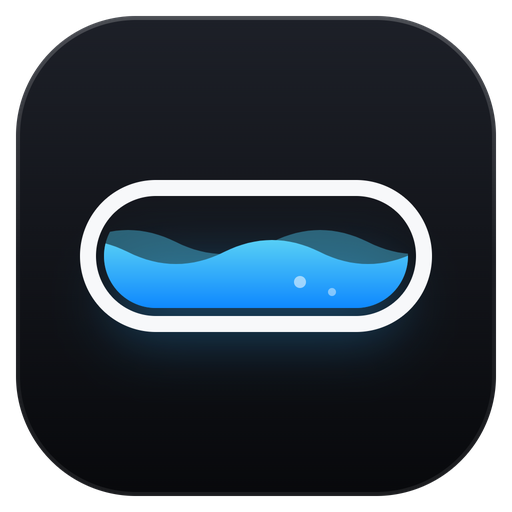

<p align="center">
  
</p>

<h1 align="center">FluidBar 5.1</h1>

> Windows 上的灵动岛：把媒体、通知、剪贴板和常用控制收进一颗小胶囊，需要时再展开。

[官方网站](https://fluidbar.doulor.cn/) · [下载 5.1.0](https://github.com/Doulor/FluidBar/releases/tag/v5.1.0) · [插件市场](https://fluidbar.doulor.cn/market/) · [问题反馈](https://github.com/Doulor/FluidBar/issues)

**当前版本：5.1.0（2026-11-11）**。修复下载更新后程序退出、未完成替换且没有重启的问题。详见 [5.1.0 发布说明](<docs/rewrite/RELEASE-5.1.0.md>)。

## 5.1.0 更新

- **支持改名的程序**：即使浏览器将下载文件保存为 `FluidBar (1).exe`，或用户自行改名，更新也会替换实际运行的文件。
- **确认就绪再退出**：助手先暂存新版、核对文件并确认就绪，主程序才退出；助手启动或准备失败时保留当前程序运行。
- **文件锁重试与恢复**：等待旧进程结束，替换遇到占用时最多重试 60 秒；使用原子替换保留旧文件，替换或启动失败时尝试恢复并重新打开旧版。
- **可排查的安装日志**：更新后的助手将过程写入 `%APPDATA%\FluidBar\updates\install.log`，记录重试、重启和恢复结果。

**4.3 / 原 5.0 用户：** 旧客户端仍使用旧更新器。如果点击“重启并安装”后程序消失，请退出旧实例，从本发行页下载 5.1.0 手动覆盖升级一次；设置和插件数据保留。不要直接在更新缓存目录内长期运行程序。

## 继续保留的 5.0 功能

- **统一图标**：使用蓝色液面图标，EXE、系统托盘、窗口 / 任务栏、设置标题栏和关于页共用同一套资源，包含适合不同 DPI 的多尺寸 ICO。[SVG 源文件](<src/FluidBar.App/Assets/fluidbar.svg>)与[图标维护说明](<src/FluidBar.App/Assets/README.md>)一并保留。
- **更顺手的详情页**：滚动条支持拖动与点击定位；拖出窗口后仍可继续拖动，松手结束。鼠标滚轮平滑滚动、反向立即响应，触控板连续输入直接跟随；普通纵向滚轮在列表边界也不会误切页。
- **稳定的液态玻璃**：修正背景截图中未定义的透明通道，防止模糊后的背景本身变透明；材质切换时保留完整背景，采样不可用时使用更实的底色回退。
- **更清晰的通知**：顶部通知将回车、换行等不可见分隔符合并为空格，避免“群名□发消息人”；详情和复制内容保留原始换行，冒号与 emoji 不受影响。
- **长通知阅读优化**：复用相同正文的换行结果，缩小首次排版的测量范围，减少详情滚动中的重复排版。

继续保留 4.3 的通知 / 剪贴板 / 文件暂存卡片、独立岛体缩放，以及更新缓存修复。5.1.0 沿用现有用户数据目录，升级不要求重置设置或插件。

## 实际界面

以下图片为 **FluidBar 4.1.0 的历史原生窗口截图**，用于展示基本使用方式；5.0.0 的统一图标和内容卡片已更新，请以当前版本为准。这些图片来自 Windows 上实际运行的程序，媒体信息来自正在运行的播放器，截图只做区域裁切，未重绘界面。拍摄环境、裁切范围见 [截图说明](<docs/screenshots/README.md>)。

### 平时保持紧凑，点击展开

正在播放时，小胶囊显示封面、曲名与播放状态：


有可用歌词时，紧凑胶囊也能直接显示当前歌词与逐字高亮，无需展开。下图为酷狗播放姚六一《雾里》时的实际状态：


展开后可切换页面，控制播放、切歌和进度；歌词是否可用取决于媒体来源，下方另一首歌曲的截图保留了实际的“暂无歌词”状态。


### 外观与插件按需配置

深浅主题、黑曜石 / 亚克力 / 液态玻璃材质、侧栏或底部预览、配色与性能模式，都可在设置中调整。


倒计时和文件暂存通过应用内市场单独安装，不会默认塞进控制中心。下图为市场页面上半部分，已裁掉含本机路径的区域。


## 能做什么

| 功能 | 说明 |
|---|---|
| **小岛与控制中心** | 悬停预览、点击展开、自动收起；浮岛、贴顶和 Dock 底部模式可选。Dock 是另一种布局，不是完整的 Windows 任务栏替代品。 |
| **媒体与系统控制** | 读取兼容播放器的媒体会话，提供播放 / 暂停、切歌、进度，以及音量、亮度等常用控制。 |
| **通知与剪贴板** | 查看系统通知；浏览、搜索、固定和复制剪贴板历史，支持文本、图片和文件内容；可暂停记录或隐藏预览。 |
| **Agent 与小组件** | 展示受支持工具的本地 Agent 状态，以及日历、待办等信息。Agent 集成依赖相应工具的本地状态或接入配置，不是内置 AI 聊天服务。 |
| **外观与交互** | 三种材质、配色、动效、显示器与位置设置；支持中文和英文，页面导航可选侧栏或底部预览。 |
| **插件扩展** | 内置媒体、通知、剪贴板、Agent、设备插件；应用内管理社区插件，支持签名包安装、更新与回滚。 |

**歌词外观：**「设置 → 插件 → 媒体详情」提供**已读歌词发光强度**，范围 0–100%、步长 5%、默认 70%。紧凑胶囊与展开媒体页共同生效，调整后即时保存并刷新；0% 仅关闭光晕，保留已读文字颜色和逐字高亮。

**可选卡片：**

- **倒计时**：支持暂停、继续和完成提醒。
- **文件暂存**：拖入文件后保留引用，可点击复制、复制全部，或拖到资源管理器 / 接收文件的应用中复制取出；**不会移动原文件**。文件暂存 1.0.3 要求 FluidBar 4.1.0 或更新版本。

倒计时与文件暂存**默认不安装**。安装与使用方法见 [可选卡片插件](<docs/plugin/optional-cards.md>)。

**快捷动作**无需安装卡片插件，可在「设置 → 通用」配置并手动执行，不新增常驻面板，也不会自动执行。

## 下载与开始使用

### 系统要求

- **Windows 10 2004（build 19041）或更新版本 / Windows 11**。
- 当前官方发行包面向 **Windows x64**，为自包含单文件，**无需另外安装 .NET**。
- 媒体控制取决于播放器是否提供 Windows 媒体会话；通知读取需要系统授权；亮度等硬件控制取决于设备与驱动支持。

### 启动与更新

1. 从 [GitHub Releases](https://github.com/Doulor/FluidBar/releases/tag/v5.1.0) 下载 `FluidBar.exe`，或下载并解压 `FluidBar-5.1.0-win-x64.zip`。
2. 将程序放在打算长期保留的目录中运行；已有旧版时，先从系统托盘退出旧版。
3. 点击小岛展开；通过设置按钮、托盘菜单或 `Ctrl + Alt + S` 打开设置。开机启动、语言和更新偏好均可在设置中调整。
4. 可使用应用内更新，或退出后手动替换程序。构建版本与下载校验值见发行页附带的 `publish-5.1.0.json`；升级说明见 [发布说明](<docs/rewrite/RELEASE-5.1.0.md>)。

4.3 / 原 5.0 用户若在“重启并安装”后程序退出且未更新，请退出旧实例后手动覆盖到 5.1.0 一次。如果旧程序名为 `FluidBar (1).exe`，替换时可保留该文件名，避免原快捷方式仍指向旧程序；升级后支持继续使用改名路径。

4.1 用户如果仍被提示“已是最新版”，可先退出重启再检查；仍检测不到时，从上方发行页手动覆盖升级一次，保留用户数据目录即可。

> 当前主程序**没有 Windows Authenticode 代码签名**，Windows 可能显示未知发布者提示。请核实下载来源与发布资产的 SHA-256，不要为安装而关闭系统安全防护。应用内更新的哈希校验不等于发布者签名认证。

### 默认快捷键

| 快捷键 | 操作 |
|---|---|
| `Ctrl + Alt + D` | 展开 / 收起控制中心 |
| `Ctrl + Alt + H` | 隐藏 / 显示灵动岛 |
| `Ctrl + Alt + S` | 打开设置 |
| 拖动收起的灵动岛 | 临时移开，松手停留约 1.2 秒后弹回已保存的位置 |
| 按住 `Ctrl` 拖动 | 保存新位置，重启后保留 |
| `Ctrl` + 单击灵动岛 | 恢复默认位置 |
| 右键灵动岛 | 临时让位并允许点击下方内容；再次右键或 3 秒后恢复 |
| 按住 `左 Alt` | 临时隐藏灵动岛 |

## 隐私与插件信任

- **匿名使用统计默认开启**，收集版本、启动耗时、会话时长等基础信息，不包含通知正文、剪贴板内容、歌曲或文件路径。可在「设置 → 通用 → 匿名使用数据」关闭，并查看待发送数据或重置匿名 ID。完整字段与保留策略见 [隐私说明](<docs/privacy/telemetry.md>)。
- 社区插件是**在主程序进程内运行的 DLL**。签名校验和能力清单用于来源校验与权限披露，**不是安全沙箱**；只安装信任的插件。
- 设置默认保存于 `%APPDATA%\FluidBar\settings.json`。反馈问题或分享截图前，请检查日志、通知、剪贴板与本机路径中是否包含私人信息。

## 开发与构建

### 技术栈

| 层 | 当前实现 |
|---|---|
| 运行时 | .NET 10 / C# 14 |
| 原生岛窗口 | Win32 分层窗口（`WS_EX_LAYERED` + `UpdateLayeredWindow`），固定宿主表面内执行动画 |
| 岛渲染 | SkiaSharp + HarfBuzzSharp，自绘文字、图标、材质和动效 |
| 设置与插件市场 | Avalonia 12.1.4 普通窗口；不再将早期 Avalonia 透明岛原型作为默认宿主 |
| 系统集成 | WinRT / Win32：媒体会话、通知、剪贴板、显示器、热键、托盘等 |
| 插件 | 无 UI 依赖的 SDK、可回收 AssemblyLoadContext、签名 `.fbp` 包与市场索引 |
| 验证 | xUnit、架构约束、原生渲染 / UI 回归和 Core 性能预算检查 |

### 本地运行与测试

开发需要 Windows 和 **.NET 10 SDK**；SDK 基线与向前滚动策略见 [global.json](<global.json>)（当前基线 10.0.301）。发布脚本需要 PowerShell 7。

```powershell
# 还原、构建与测试
dotnet restore FluidBar.sln
dotnet build FluidBar.sln -c Release --no-restore -p:RunAnalyzers=false
dotnet test FluidBar.sln -c Release --no-build

# 启动桌面应用
dotnet run --project src/FluidBar.App -c Release

# Core 合成场景的性能 / 预算检查（不等同于真实桌面长期浸泡测试）
dotnet run --project tests/FluidBar.Soak -c Release
```

测试覆盖与历史验收记录见 [当前状态](<docs/rewrite/STATUS.md>)，不在此固定易过期的测试总数。构建后按 [构建卫生规则](<docs/build-hygiene.md>) 管理本次生成的产物，避免重复创建大体积隔离输出。

### 生成自包含发布包

使用与正式发布流程一致的 [发布脚本](<build/publish.ps1>)：

```powershell
pwsh -File ./build/publish.ps1 -Version 5.1.0 -SelfContained
```

脚本执行第一方项目的编译警告门禁及完整解决方案回归，并生成单文件 win-x64 程序、ZIP 和 SHA-256 / 构建报告，分别位于 `build/publish/win-x64`、`build/artifacts` 和 `build/reports`。版本默认读取 `Directory.Build.props`，显式版本的基础版本必须与其一致；预发布使用如 `5.1.0-rc.1` 的后缀，不再用预览轮次替代主版本号。

版本采用 `主版本.次版本.修订号`，兼容性与迁移要求会在发布说明中列出。测试轮次使用 `-preview.N` 或 `-rc.N`，正式版本发布后不覆盖原标签和资产。

### 仓库结构

```text
src/
  FluidBar.Core/               领域模型、活动调度、布局、动效、设置
  FluidBar.Island/             SkiaSharp 岛渲染器、主题、排版与交互模型
  FluidBar.Sdk/                插件契约与 manifest 模型（无 UI 依赖）
  FluidBar.PluginHost/         插件加载、生命周期、异常处理与卸载
  FluidBar.Marketplace/        .fbp 打包、签名、索引、安装、更新与回滚
  FluidBar.Platform.Windows/   Win32 / WinRT 系统服务与原生窗口
  FluidBar.Plugins.Builtin/    媒体、剪贴板、通知、Agent、设备内置插件
  FluidBar.App/                应用组合、原生岛宿主、Avalonia 设置与市场
  FluidBar.Cli/                fluidbar-plugin 命令行工具
plugins/
  samples/                    最小与丰富插件示例
  fluidbar-*/                 倒计时、文件暂存等可选插件
marketplace/                  市场索引与插件发布资料
schemas/                      插件、索引、语言包与签名 JSON Schema
tests/                        Core / Island / UI / 平台 / 插件 / 集成等测试
website/                      官网与浏览器交互演示（Vite + React）
telemetry/                    匿名统计服务
docs/                         发布、设计、插件、隐私与截图文档
```

## 文档与贡献

- **用户与发布**：[发布说明](<docs/rewrite/RELEASE-5.1.0.md>) · [变更记录](<CHANGELOG.md>) · [可选插件](<docs/plugin/optional-cards.md>)
- **开发与维护**：[文档索引](<docs/rewrite/README.md>) · [当前状态](<docs/rewrite/STATUS.md>) · [项目方向与约束](<PROJECT-NOTES.md>) · [架构决策](<docs/rewrite/DECISIONS.md>)
- **插件作者**：[快速开始](<docs/plugin/quickstart.md>) · [审核清单](<docs/plugin/review-checklist.md>) · [插件文档](<docs/plugin/>)
- **视觉参考**：[浏览器交互原型](<docs/rewrite/prototype2/index.html>)使用示例数据，供交互参考，不等同于原生应用。旧版实现可在 `v1-final` 标签与 Git 历史中查阅。

项目由 **Doulor** 维护。欢迎通过 [Issues](https://github.com/Doulor/FluidBar/issues) 提交问题与建议，或通过 Pull Request 贡献代码、翻译和插件。报告问题时请附版本、Windows 版本、复现步骤，以及已去除私人信息的日志或截图。

## 许可证

[MIT](<LICENSE>)。
