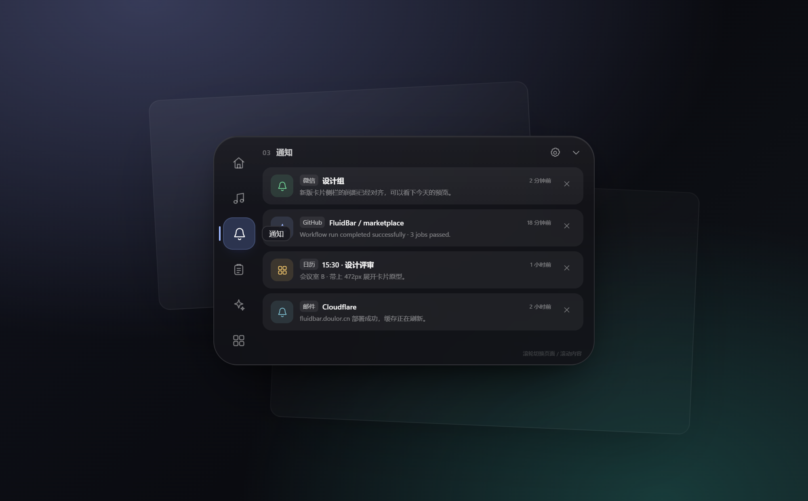

# 展开卡片侧栏原型（v2）

直接双击 `index.html` 打开，无需构建。图标复用
`../rewrite/prototype2/icons.js`，其余样式与交互均在当前目录。

## 设计决定

- 卡片从 440×284 加宽到 **472×284**，只增加 32 DIP；现有六页仍按 400×260
  绘制，不压缩内容、不缩放字体。
- 原来的附属预览小岛（上一页/当前胶囊/下一页 + 远页圆点）删除，替换为卡片内
  左侧 **40×260 的图标栏**：六个 40×40 按钮，间距 4，正好填满高度。
- 内容区仍在 400×260：左侧图标栏 10..50，间隔 10，内容 60..460。
- 当前页按钮使用淡紫填充 + 左侧 2 DIP 指示条；悬停按钮使用白色 7.5% 底，
  所有快捷开关、列表行、操作按钮、日历箭头、任务行都有 hover/active 反馈。

## 交互

- 点击左侧图标直接跳页。
- 鼠标滚轮：
  - 指针在侧栏上：滚轮直接切页；
  - 指针在可滚动内容上：先滚动列表；
  - 列表到达顶部/底部后：继续滚轮切上一页/下一页；
  - 指针在短页面上：直接切页。
- 上下方向键 / PageUp / PageDown 也可切页。
- 原型里通知关闭、剪贴板复制、任务勾选、快捷开关和媒体按钮都有可点击反馈。

## 预览

## 截图

页面截图在 `.local/proto-shots/`（不入库）；最终卡片截图在
`.local/proto-shot.png`。生产实现确认后再移植到 Skia 渲染器，避免先把
472 DIP 的尺寸决定写死。
